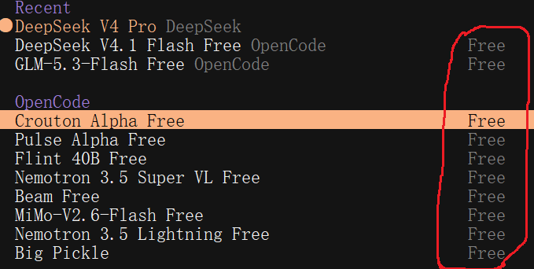
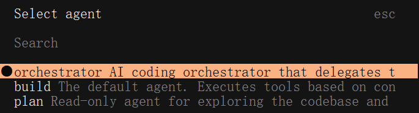
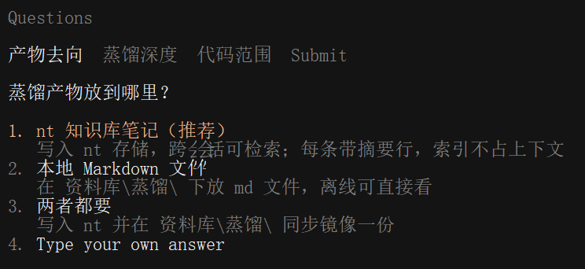
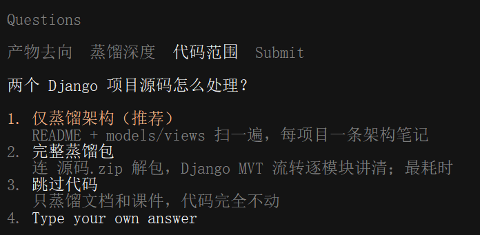
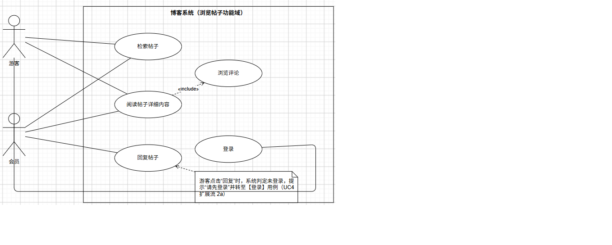
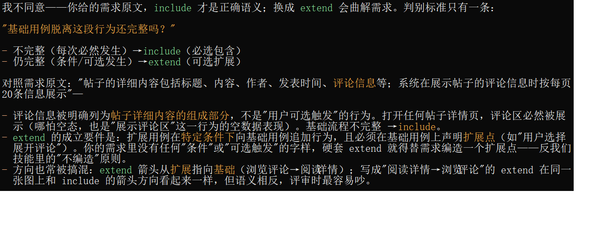
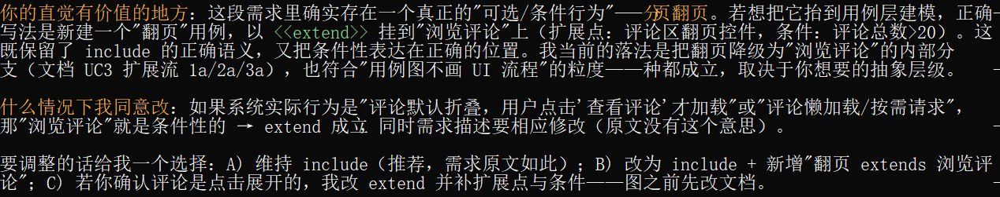
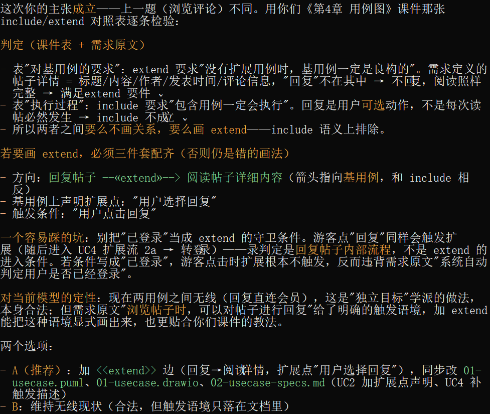
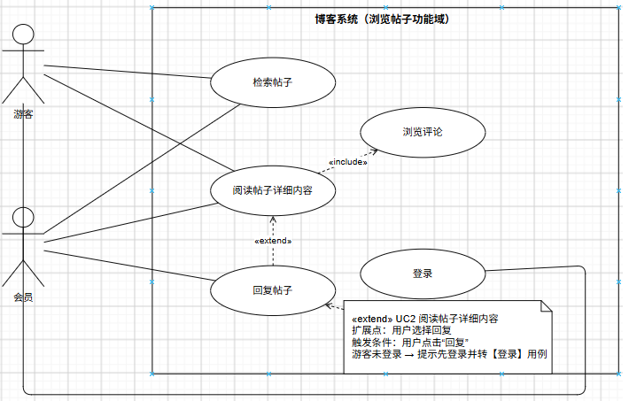

# AI 辅助软件分析与设计教学案例

> **案例主题**：博客系统“浏览帖子”——从需求、用例模型、分析模型到软件设计说明书的完整 AI 辅助建模过程
> **工具链**：opencode + omo-slim + draw.io + nt
> **工作目录**：`D:\workspace\softengineering`，全部建模产出位于 `uml/` 目录
> **案例时间**：2026-11-09 ～ 2026-11-10

## 导读

### 案例背景

本案例以博客系统的“浏览帖子”功能为业务对象，完整演示在 AI 编程助手 opencode 的辅助下，按照面向对象软件工程方法完成：

**需求分析 → 用例模型 → 分析模型 → 设计模型 → 软件设计说明书**

的全过程。案例既包含环境搭建、知识库蒸馏、技能创建等准备工作，也保留了人与 AI 围绕模型正确性展开的评审对话（include/extend 之争、分析阶段是否应出现 MVC 控制类、顺序图的片段嵌套等），可用于课堂演示、上机实训或课后复盘。

### 教学目标

1. 搭建 AI 辅助软件开发环境：安装 opencode、omo-slim、draw.io 与 nt，并完成知识库蒸馏。
2. 依据知识库创建可复用的 UML 建模技能，理解“技能”在 AI 工作流中的作用。
3. 掌握“需求 → 用例模型 → 分析模型 → 设计模型 → 设计说明书”的三段式建模流程与各阶段产出。
4. 能评审 AI 生成的 UML 模型，识别 include/extend 误用、分析与设计边界混淆、顺序图的片段语义错误等问题。
5. 建立“AI 生成 + 程序化校验 + 人工评审”的协作意识，理解一致性约束在跨图建模中的重要性。

### 阅读路线

| 部分 | 内容 | 建议用法 |
|------|------|----------|
| 第一章 | 工作环境准备、插件安装、知识库蒸馏 | 上机前按步骤操作 |
| 第二章 | 创建 uml-modeling 技能；用例模型与时序图演示 | 课堂演示 |
| 第三章 | 分析类图 → 设计类图 → 设计级顺序图 → 活动图 → 设计说明书（完整会话实录） | 核心案例，可逐轮讲解 |
| 第四章 | 方法论小结、教学要点与讨论题 | 课后总结 |

> 说明：本文档由《AI辅助软件开发教学要点》与《AI辅助软件分析与设计案例》合并整理而成；第三章保留原始会话的轮次编号与 AI 回复，仅统一了提示词排版，文件路径、图件名称均以 `uml/` 目录实际产出为准。

---

## 一、工作环境准备

### 1. 安装 opencode 及相关插件

- 以 opencode 为例演示 AI 工具参与软件开发。也可以使用其他 AI 工具（Trae、WorkBuddy、ChatGPT 等）。
- 首先安装 opencode CLI，这是一个基于命令行的 AI 工具。

opencode 安装好之后首先需要连接大语言模型，opencode 提供了许多免费的大语言模型：



- opencode 自带了 2 个智能体（Agent）：build 和 plan。为了能提高 Agent 的工作效率、编排任务的执行，我们需要安装一个插件 omo-slim（在 opencode 1.x 的版本中，插件是 oh-my-opencode；在 opencode 2.x 的版本中使用 omo-slim）。omo-slim 完整的 Agent 团队包括 7 个 Agent（1 个主 Agent + 6 个子 Agent）：

  - **Orchestrator**（编排器）：主 Agent，负责规划任务、调度和协调其他专家。
  - **Explorer**（探索者）：子 Agent，负责侦察代码库。
  - **Oracle**（先知）：子 Agent，负责查询最新文档或进行深度分析。
  - **Council**（议会）：子 Agent，可以并行运行多个模型来对比答案。
  - **Librarian**（图书管理员）：子 Agent，负责检索信息。
  - **Designer**（设计师）：子 Agent，负责处理 UI 相关的工作。
  - **Fixer**（修复者）：子 Agent，负责执行具体的代码修改任务。

- 成功安装 omo-slim 后，在 opencode 命令行中调用 `/agents`，可以看到：



默认情况下，使用 orchestrator 主 Agent，由它自主调度其它的 SubAgents。

- 然后安装一下其他你觉得需要的插件和技能。为了本课程的进行，需要 2 个必备的插件：draw.io 和 nt。

draw.io 插件用于绘制软件工程中各种模型图；nt 用于蒸馏知识。

#### 1.1 安装 omo-slim

在 opencode 命令行输入：

```prompt
安装omo-slim插件
```

#### 1.2 安装 draw.io 插件

在 opencode 命令行输入：

```prompt
安装draw.io插件
```

#### 1.3 安装蒸馏插件 nt

**方式一**

- 从 https://github.com/navbytes/nt/releases/tag/v0.31.0 下载 nt。
- 为 opencode 安装 nt 插件，在命令行运行：

```prompt
nt opencode install
```

**方式二**

在 opencode 的命令行里输入：

```prompt
安装蒸馏插件“nt”
```

> 备注：其实，所有的插件和技能都可以直接在 opencode 命令行里提要求，由 AI 自动安装。优点是省心，缺点是耗 Token。

### 2. 蒸馏知识库

准备好要蒸馏的资料到一个文件夹下，如“资料库”：

```prompt
我要蒸馏文件夹 @资料库\ 下的所有文档资料，告诉我如何做的步骤，待我确认后再执行。
```

AI 会向你确认，如：





---

## 二、AI 辅助软件建模

### 1. 创建技能

提示词：

```prompt
根据知识库创建uml建模的技能"uml-modeling"，使得能根据需求分析创建用例图和用例文档，然后根据用例图和用例文档创建对象图、类图、时序图、协作图、活动图、状态图、实体关系图等模型。如果这个技能你觉得太大，你可以分别为每个模型创建一个技能，技能命名的规则是在"uml-modeling"后加上模型的名字。
```

### 2. 案例演示：博客系统“浏览帖子”

#### 2.1 从需求文档到用例模型

```prompt
用uml-modeling为下面的需求创建用例模型；开发一个博客系统，其中有一项功能：浏览帖子，具体描述如下：对于会员和未注册游客，均拥有根据帖子标题进行检索，阅读帖子的详细内容的功能，帖子的详细内容包括标题、内容、作者、发表时间、评论信息等；系统在展示帖子的评论信息时按每页20条信息展示，可前后翻页查看；浏览帖子时，可以对帖子进行回复信息，系统自动判定用户是否已经登录，已登录的会员可回复帖子，否则系统提示先登录才能回复帖子。调用draw.io绘制出用例图。
```

输出的结果：



```prompt
在用例图中，你把"阅读帖子详细内容"与"浏览评论"两个用例之间的关系建模为"include",我认为应该是"extend"，你怎么看？
```

AI 回答：





```prompt
我觉得"回复帖子"与"阅读帖子详细内容"之间的关系是"extend"，你如何评判？
```



```prompt
选A
```



```prompt
为前面生成的用例图编写用例规格说明
```

#### 2.2 用时序图实现用例模型

```prompt
针对需求已经建立用例模型和用例规格说明，见 @uml/01-usecase.drawio 和 @uml/02-usecase-specs.md .你运用 @uml-modeling 技能对每个用例使用时序图实现，每个时序图使用 @drawio 技能绘制，输出时序图文件命名规则"用例名称-sequence.drawio".
```

```prompt
在这些时序图中，"alt"似乎可以在表示分支和循环时都是相同的，我认为在知识库中"ECP"这个示例中时序图表示分支和循环的方式更好，你是否认同我的观点，你不需要讨好我，以客观的态度评价。
```

```prompt
我阅读了模型的时序图，在uml目录下所有形式如"*-sequence.drawio"的文件。我发现在时序图中，建立了控制器对象，那是不是可以认为此时已经默认系统将使用MVC模式，这在系统分析阶段合适吗？这一阶段主要是分析系统的类和对象模型，还不涉及实现架构吧？你对此如何评价？你只做评述，不修改已有文件，你要保持客观的立场作出评述。
```

> 教学提示：以上两问分别指向“UML 片段的语义表达”和“分析与设计的边界”。控制类（«control»）是分析阶段的责任划分，不等于 MVC 架构中的 Controller；分析模型不应渗入实现技术，技术口径留到设计阶段确定。这两个问题也是后续第三章设计工作的伏笔。

用例模型与时序图完成后，进入软件分析与设计阶段，完整会话见第三章。

---

## 三、AI 辅助软件分析与设计（完整会话实录）

### 案例说明

- 本部分收录“软件分析与设计”阶段的**全部用户提示词**与 **AI 回复**，按轮次编排。
- 未收录：思考过程（thinking）、工具调用过程（文件读写、校验脚本等）、系统消息（system-reminder / system-update）。
- 首轮消息随提示词注入了两个技能的完整说明（`uml-modeling`：需求→分析→设计三段式 UML 建模流程；`drawio`：draw.io 图表生成规范），此处以一行摘要代替全文，避免冗余。
- 用户消息中附带的文件内容（如 drawio XML 全文）以“（附：……，此处略）”标注。

### 第 1 轮：创建分析类图

**提示词**：

```prompt
根据用例模型和时序图，使用 @uml-modeling 创建分析类图，并用 @drawio 技能输出到"analysis-class.drawio"
（本条消息同时加载 uml-modeling 技能与 drawio 技能说明全文，略。）
```

**AI 输出**：

分析类图已完成并校验通过：`D:\workspace\softengineering\uml\analysis-class.drawio`

**内容**

- 11 个分析类：3 边界（检索页面/详情页面/登录页面）、5 控制（检索/帖子/评论/回复/登录控制器）、3 实体（帖子/评论/会员），按 ECB 三列着色布局，与顺序图颜色一致。
- 实体关联带多重性：会员 1—0..\* 帖子、会员 1—0..\* 评论、帖子 1—0..\* 评论（组合，实心菱形在帖子端）。
- 控制器协作：`«include» UC3`（帖子控制器→评论控制器）、`«extend» UC4` 说明；`判定登录状态`（回复控制器→登录控制器）。

**建模口径**（图内附注说明）

- 回复按需求模型假设 1 归入评论，不单列实体类；游客是参与者角色，不建实体；登录态落在登录控制器「当前会员」属性。
- 图内带名词-动词分析与 UC1–UC5 覆盖说明；5 张顺序图的全部生命线均已覆盖，无实现技术词。

**校验**

- XML 可解析、无注释/未转义字符/自闭合边；几何检查无类框交叉。本机未检测到 draw.io CLI，未做 PNG 预览——直接用 draw.io 打开即可查看。

---

### 第 2 轮：工作步骤大纲

**提示词**：

```prompt
我现在已经获得分析类图，按面向对象软件工程方法我接下来如何继续开展项目的分析与设计工作？你给我列一个工作步骤大纲，告诉我每一步的工作内容和产出。
```

**AI 输出**：

按你项目的现状（用例模型 ✓ → 分析类图 ✓，5 张分析级顺序图 ✓），接下来按「完成分析模型 → 设计模型 → 设计文档」推进。大纲如下，产出沿用 `uml/` 目录编号。

#### 阶段 1：收尾分析模型（2 件，可按需裁剪）

**第 1 步：对象图（校验类图）**

- 内容：取 1–2 个关键场景（UC2 阅读帖子详情、UC4 回复）画对象快照，用实例和链接验证类图“装得下”真实数据、多重性无矛盾。
- 产出：`04-object.drawio`。类图直观且已与顺序图互检时可跳过。

**第 2 步：ER 图（数据模型）**

- 内容：帖子/评论/会员三实体的属性、主键、1:N 关系（会员—帖子、帖子—评论、会员—评论）。
- 产出：`05-er.drawio`。本系统数据不密集，属可选项；课程若要求数据模型则做，且作为后续建表依据。

#### 阶段 2：设计模型（核心，按序执行）

**第 3 步：细化设计类图** ← 建议从这里开工

- 内容：分析类图 → 设计类图：属性定类型、方法补签名、标可见性（+/-/#）、导航方向；决策点：分页结果如何表示（页码+列表参数 vs 分页对象）、登录会话放哪（登录控制器的当前会员）；用 GRASP 检查——信息专家（“按时间倒序”放在评论控制器还是评论集合）、低耦合高内聚、单一职责。
- 产出：`06-design-class.drawio`。依据：张海藩 11 章、UML-OOAD `uml06`、课件第 5 章。

**第 4 步：顺序图升设计级**

- 内容：现有 5 张顺序图的生命线是分析类（«boundary»/«control»/«entity»），升级为设计类对象，消息写成方法调用（带参数/返回值），保持 UML 2 片段（opt/alt/loop/ref）。
- 产出：`07-{用例}-design-sequence.drawio` ×5（或就地升级）。保证“顺序图中的类都在设计类图出现”。

**第 5 步：通信图**

- 内容：补对象结构视角，选 UC2 或 UC4 画 1–2 张，展示链接与编号消息，与顺序图同构。
- 产出：`08-communication.drawio`。依据：课件第 9 章。

**第 6 步：状态图（按需，先判定）**

- 内容：找生命周期 ≥3 状态的类。当前需求里帖子只有“存在/已删除”、登录态只有“未登录/已登录”，都不足 3 态；可在说明书中写明“无适用类”而跳过，若课程要求画，就画「登录会话状态图」。
- 产出：`09-state.drawio`（可选）。依据：课件第 10 章。

**第 7 步：活动图**

- 内容：UC4 回复帖子（登录判定、空内容校验、保存并刷新）和 UC5 登录（凭证错误循环）分支多，画 1–2 张活动图。
- 产出：`10-activity.drawio`。依据：课件第 11 章。

**第 8 步：包图（架构，任务要求时）**

- 内容：三层包图——界面（边界类）/控制（控制类）/领域（实体类），标注依赖方向（界面→控制→领域，不允许反向）；课程要求再补组件图/部署图。
- 产出：`11-package.drawio`。依据：UML-OOAD `uml08`、课件第 7 章。

#### 阶段 3：设计文档与实现准备

**第 9 步：软件设计说明书（SDD）**

- 内容：汇总 3–8 步的全部决策——设计类图说明、逐用例设计实现（引用顺序图/通信图）、数据模型（ER → 表结构）、设计原则与模式应用点（GRASP/SOLID、用到了哪些 GoF 模式）、界面原型（可选，参照 ECP·界面原型成例）、假设清单与未覆盖需求。
- 产出：`设计说明书.md`（含图清单表 + 一致性自检）。可参照 KB 成例「网上书店系统·软件设计说明书」。

**第 10 步：模型 → 代码（进入实现阶段）**

- 内容：设计类图 → 类骨架，ER → 建表脚本，约定命名/映射规则；之后进入编码与测试（张海藩 7/12 章、智能软件工程 Ch5/Ch6）。
- 产出：代码仓 + 测试用例，已超出“分析与设计”范围。

**贯穿全程的两条硬约束**：①同名元素跨图一致（类名、关系、多重性）；②每个用例在设计中 ≥1 张顺序图。每步完成时做一次跨图自检。

建议从第 3 步（设计类图细化）开工，需要的话我可以直接按这份大纲逐项产出。

---

### 第 3 轮：设计类图（含技术口径提问）

**提示词**：

```prompt
从第2步到第9步开始，按这份大纲逐项产出
现在开始执行第3步，开始细化设计类图，需要我指定开发语言和开发框架吗？等待我回复再开始执行。
```

**AI 回复（就“是否指定语言/框架”的答复）**：

需要，但分两层看：

- **开发语言**：建议指定。它决定设计类图的属性类型与方法签名的写法（`String` vs `str`、`List<Post>` vs 列表切片、`Date` vs `datetime`），以及可见性/集合的表达习惯。
- **开发框架**：一般**不需要**。框架只在你准备把设计类图推向技术分层（如引入 `«Controller»/«Service»/«Repository»` 或 DAO 层）时才影响图面；课程级设计类图通常不画框架内部类，分层用包图（第 8 步）表达即可。

所以：语言建议定一个（哪怕是文档口径），框架可空着。

**AI 提问**：设计类图按哪种技术口径细化？（决定属性类型与方法签名写法；框架默认不画入类图，除非你要求 Web 分层）

- ① 语言无关（推荐）：类型用 String/Integer/Boolean/Date 通用写法，签名伪代码化，不绑定具体语言与框架。课程文档最常见，后续实现时再映射。
- ② Python（Flask/无框架）：类型用 str/int/bool/datetime，集合用 list；若要求 Flask 分层则补充路由/视图说明。
- ③ Java + Spring Boot：类型用 String/int/Long/Boolean/Date，引入 Controller/Service/Repository 分层与 List\<T\> 集合。
- ④ C# / .NET：类型用 string/int/long/bool/DateTime，集合 List\<T\>，可见性按 C# 惯例（public/private/internal）。

**用户回答**：我决定使用 python + Flask 开发

**AI 输出（第 3 步执行结果）**：

第 3 步完成：`D:\workspace\softengineering\uml\06-design-class.drawio`

**设计类图内容（15 个类，20 条关系）**

- 保留分析模型全部 11 个类（类名不变），新增 4 个：帖子DAO / 评论DAO / 会员DAO（数据访问层）、分页结果（值对象）。
- 按 Python 3 + Flask 口径细化：属性带类型（str/int/bool/datetime/List/Optional）、方法带签名与返回类型、可见性 +/-（“-”标注约定私有）。
- 关键设计决策（图内两处注释）：每页 20 条 → 评论控制器类常量；登录态 → 登录控制器.当前会员（Flask session 承载）；分页数据收敛为分页结果对象；实体退为纯数据类，查询/保存下沉到 DAO（信息专家）。
- 实体关联沿用分析模型：会员 1—0..\* 帖子/评论，帖子 1—0..\* 评论（组合）。
- 未画 Flask 框架内部类，分层留到第 8 步包图。

**校验**：XML 可解析、无类框交叉、20 条边全部端点有效；可直接用 draw.io 打开。

下一步是第 4 步：把现有 5 张顺序图升级为设计级（生命线换成设计类，消息改为方法调用，链路变为 页面→控制器→DAO→实体）。是否继续？

---

### 第 4 轮：设计级顺序图

**提示词**：

```prompt
继续，设计级顺序图命名规则"*-sequence-design.drawio"
```

**AI 输出**：

第 4 步完成：5 张设计级顺序图已按 `*-sequence-design.drawio` 命名规则生成于 `D:\workspace\softengineering\uml\`。

| 文件 | 生命线（设计类） | 消息 | 片段 |
|------|------------------|------|------|
| 检索帖子-sequence-design.drawio | 用户 · 检索页面 · 检索控制器 · 帖子DAO | 8 | alt |
| 阅读帖子详细内容-sequence-design.drawio | 用户 · 详情页面 · 帖子控制器 · 帖子DAO · 评论控制器 · 评论DAO | 12 | alt + ref(UC4) |
| 浏览评论-sequence-design.drawio | 用户 · 详情页面 · 评论控制器 · 评论DAO | 13 | alt + loop + 嵌套 alt |
| 回复帖子-sequence-design.drawio | 用户 · 详情页面 · 回复控制器 · 登录控制器 · 评论控制器 · 评论DAO | 20 | alt + ref(UC5) + alt |
| 登录-sequence-design.drawio | 游客 · 登录页面 · 登录控制器 · 会员DAO · 会员 | 13 | loop + alt + 自消息 |

**升级要点**

- 生命线从分析类换成设计类对象（含新 DAO 层）；消息改为方法调用（带参数/返回类型），返回用虚线箭头。
- 消息链为 页面→控制器→DAO→实体；UC4 保存回复经 评论DAO.保存()，刷新走 回复控制器→评论控制器；UC5 补了 会员.校验密码() 调用。
- UML 2 片段规则保留（opt/alt/loop/ref，嵌套内缩）。

**校验**：5 个文件 XML 均可解析；全部生命线均来自 06-design-class.drawio（演员除外）；每个用例 ≥1 张顺序图的判据满足。

下一步第 5 步：通信图（选 UC2 或 UC4 画 1–2 张）。继续吗？

---

### 第 5 轮：UC3 顺序图评审 → v2

**提示词**：

```prompt
@uml/浏览评论-sequence-design.drawio 有2点问题需要你确认：1.只有"评论DAO"类，没有"评论"类？2.片段alt,loop框线的包含边界显示混乱。评估我的问题，确定是否要修改，如果要修改则输出新的文件"浏览评论-sequence-design-v2.drawio"
（附：`uml/浏览评论-sequence-design.drawio` 文件内容，此处略。）
```

**AI 输出**：

两个问题的评估与处理：

**问题 1 — 评估：不是错误，属设计细化；但 traceability 断裂，已补救**

设计级中 评论 实体是纯数据类：它不接收任何消息，只是被 评论DAO.分页查询() 加载后封装进 分页结果.条目。UML 中给不接收消息的对象画生命线反而是错误的（生命线必须参与交互）；分析级的“评论”生命线在设计级被 **评论DAO + 分页结果** 取代（查询职责下沉到 DAO，正是信息专家原则）。v2 的补救方式（不硬加生命线）：

- 返回消息标注载荷类型：`分页结果(第1页 · 条目: List[评论])`；
- 图下注释写明取代关系及理由。

**问题 2 — 评估：确属错误，已修复**

原图 loop 帧（620–1180）从 alt 帧（430–750）内部起始却伸出其底边，alt 底边线横切 loop 帧和嵌套 alt 帧顶部，msg-6 视觉上落在 alt 的 else 分支内。v2 改为**顺序片段**结构：

- alt1（430–650）：首页展示，[≤20 无控件 / >20 有控件]；
- loop（690–1240）：用户翻页，**完全独立于 alt1**（顺序关系，不再是 alt 的分支）；
- 嵌套 alt2（814–1200）：目标页越界判定，**完全包含在 loop 内**。

**产出**：`D:\workspace\softengineering\uml\浏览评论-sequence-design-v2.drawio`（原 v1 文件保留未动）。校验：XML 可解析；帧包含关系经程序检查——无骑跨、嵌套帧完全被包含；全部 13 条消息均落在正确的分支区间内。

顺带提醒：其他 4 张图没有此类骑跨（它们的 ref/alt 都是独立或全包含），不需要连带修改。

---

### 第 6 轮：UC3 顺序图语义修正 → v3

**提示词**：

```prompt
我认为v2还是有错误，用户翻页loop，不是完全独立于alt1的，因为只有评论总数>=20时才需要翻页。你评估我的意见，如有修改输出到新的v3版文件。
```

**AI 输出**：

评估：你的意见正确。用例扩展流 A-1 明确“评论总数 ≤ 20 → 不显示翻页控件”，所以翻页循环只在 `> 20` 分支内可达；v2 把 loop 放在 alt1 之外，读图时会误认为“即使 ≤ 20 也进入翻页循环”。正确结构应是 loop **嵌套在 alt1 的 else 分支内**（这正是原分析图想表达的结构，v1 的错误在于帧边界画破，而不是嵌套本身）。输出 v3：`D:\workspace\softengineering\uml\浏览评论-sequence-design-v3.drawio`（v1/v2 保留未动）。

**v3 结构**（修正了 v2 的语义缺陷）：

```
alt1 [评论总数 ≤ 20 — A-1] ────────────────
     │ 展示第1页评论（不显示翻页控件）
     ├────────────────────────────────────
     [评论总数 > 20]
     │ 展示第1页评论 + 翻页控件
     │  loop [用户选择翻页]          ← 嵌套在 else 分支内
     │    │ 选择"上一页/下一页"(目标页码)
     │    │  alt2 [目标页超出范围 — A-2/A-3]
     │    │    │ 对应翻页按钮不可用
     │    │    ├────────────────
     │    │    [目标页有效]
     │    │    │ 浏览评论 → 分页查询 → 分页结果 → 展示该页评论
     └────────────────────────────────────
```

- 翻页 loop 只存在于 `评论总数 > 20` 的分支内：≤ 20 时无翻页控件，循环不可达，语义与 A-1 一致。
- 帧包含关系经程序校验：loop（660–1280）完全包含于 alt1（430–1320），alt2（780–1240）完全包含于 loop，无骑跨、无破边；13 条消息均落在正确的分支区间。
- v2 的两处修复（返回消息标注 `条目: List[评论]`、图下说明 评论 实体为何不设生命线）在 v3 中保留，并新增“说明 2”记录本次嵌套依据。

至此 UC3 共三版：v1（帧破边）→ v2（帧完好但语义错）→ v3（帧完好且语义正确）。其他 4 张图的帧结构无此类问题，不需连带修改。

---

### 第 7 轮：活动图（UC4、UC5）

**提示词**：

```prompt
执行第7步，绘制UC4和UC5的活动图，产出为"UC4-activity.drawio" 和 "UC5-activity.drawio"
```

**AI 输出**：

第 7 步完成，两个文件已生成并校验：

**`uml/UC4-activity.drawio`** — 回复帖子

- 4 泳道：用户 / 详情页面（界面）/ 控制层（回复·登录·评论控制器）/ 评论DAO（数据访问）
- 20 节点、21 条边：起止节点、14 动作、2 判定（登录状态、回复内容）、2 合并
- 守卫条件：`[未登录 — A-2]` → 提示并“转 UC5 登录”；`[已登录]` 直接合并；`[内容为空 — A-4]` → 提示后**回环**到输入；`[内容有效]` → 保存评论（评论DAO）→ 刷新评论列表（分页查询）→ 新回复显示于首位

**`uml/UC5-activity.drawio`** — 登录

- 4 泳道：游客 / 登录页面（界面）/ 登录控制器 / 会员DAO·会员（数据/实体）
- 14 节点、14 条边：含“按用户名查询 → 校验密码”两步数据访问动作
- 守卫条件：`[凭证错误 — A-4]` → 提示后**回环**到“输入用户名与密码”（合并节点）；`[凭证正确]` → 建立登录态 → 返回原页面；注释记录假设 6（失败次数不限）

**校验**：两文件 XML 均可解析；程序化几何检查——无节点重叠、无边穿越无关节点（回环边均以泳道间隙走直角弯，不压过动作节点）。

说明：第 6 步状态图经评估不适用（帖子/登录态均不足 3 个状态，已在前述大纲中注明可跳过），故第 7 步直接执行。剩余第 5 步（通信图）、第 8 步（包图）、第 9 步（设计说明书）待命，需要哪一步直接说。

---

### 第 8 轮：软件设计说明书

**提示词**：

```prompt
执行第9步，撰写设计说明书
```

**AI 输出**：

第 9 步完成：`D:\workspace\softengineering\uml\设计说明书.md`（376 行）

**文档结构**（沿用「网上书店系统·软件设计说明书」成例框架，按本项目裁剪）：

| 部分 | 内容要点 |
|------|----------|
| 1 引言 | 编写目的、命名规范（含中英文类名映射表）、术语定义、参考/相关文档、版本信息 |
| 2 总体设计 | 软硬件环境（Python 3.10+ / Flask 3.x / SQLite）、四层子系统清单、UC1–UC5 功能模块清单 |
| 3 数据库设计 | member / post / comment 三表关系与详细字段（含外键、级联删除） |
| 4 典型子系统设计 | 逐用例：参与类 + 顺序图消息链走查 + 活动图（UC4/UC5），全部扩展流覆盖 |
| 5 页面模块设计 | /search、/post/\<id\>、/login 三页面的参数/调用背景/页面设计/调用描述 |
| 6 DAO 设计 | 三个 DAO 的方法与 SQL 要点（LIKE 检索、LIMIT/OFFSET 分页、INSERT） |
| 7 接口设计 | 用户接口、外部接口（无）、关键方法签名表（前置/后置条件） |
| 8 角色授权 | 游客/会员权限表、登录态判定机制 |
| 9 错误处理 | 出错信息表（A-2/A-3/A-4 全路径）、故障预防、维护设计 |
| 10 测试计划 | 单元/控制器/页面/场景四层测试重点 |
| 附录 A/B/C | 图件清单、一致性自检（含 UC3 v3 帧修正结论）、假设清单（7 条，含设计期新增“密码哈希存储”）+ 未覆盖需求 |

文档中的一致性声明均与现有图件实际核对过（每个用例 ≥1 张顺序图、生命线 ⊆ 设计类图、多重性跨图一致等）。

**大纲剩余项说明**：第 5 步通信图、第 8 步包图未做（文档 2.3 节已用文字描述分层）；第 2 步 ER 图未画，但第 3 部分已用表关系文字+表格覆盖其内容。如需补齐通信图/包图/ER 图任一，说一声即可。

---

### 第 9 轮：项目实现

**提示词**：

```prompt
根据 @教学内容/博客系统软件设计说明书.md 使用python+flask+sqlit开发项目，项目源代码输出到 "blogs"
```

**AI 输出**：项目已生成到 `blogs/`，按设计说明书的四层结构实现 UC1–UC5。

**运行方式**
```powershell
cd blogs
python -m pip install -r requirements.txt
python seed.py          # 重建演示数据库（3 会员 / 6 帖子 / 69 评论）
python run.py
```
访问 http://127.0.0.1:5000

演示账号：`alice / alice123`、`bob / bob123`、`carol / carol123`

**实现内容**
- 界面层：`pages/` + 5 个 Jinja2 模板，检索页 / 详情页 / 登录页
- 控制层：检索、帖子、评论、回复、登录 5 个控制器
- DAO 层：`PostDAO`、`CommentDAO`、`MemberDAO`，SQLite 直连、参数化 SQL、外键级联
- 实体/值对象：`Post`、`Comment`、`Member`、`PageResult`
- 评论每页 20 条倒序、翻页控件显隐与禁用、越界页码钳制
- 回复登录判定、`next` 返回原帖、空内容校验、新回复居首
- 密码 `werkzeug` 哈希存储、session 登录态、开放重定向防护、XSS 转义
- `README.md` 含类映射、表结构、路由、配置、假设与测试说明

**验证结果**
- `python -m pytest -q`：**39 passed**
- 真实 Flask 服务冒烟检查：`/search`、`/post/1`、静态 CSS 均返回 200

注意：`seed.py` 会删除并重建 `blogs/instance/blog.sqlite3`，仅用于演示数据初始化。

---

## 四、方法论小结与教学要点

### 1. 方法论小结（本案例体现的可复用工作流）

1. **需求 → 分析 → 设计三段式**：用例模型（三件套）→ 名词-动词分析出 ECB 分析类 → 设计类图细化（定型/签名/可见性/导航）。
2. **分析模型不渗入实现技术，设计模型才定技术口径**（本案例：Python 3 + Flask，不画框架内部类）。
3. **一致性约束贯穿全程**：同名类/关系/多重性跨图一致；顺序图生命线 ⊆ 设计类图；每个用例 ≥1 张顺序图。
4. **评审驱动迭代**：用户两轮评审揪出 UC3 顺序图的帧破边与语义错误（v1→v2→v3），AI 逐轮评估、修复并保留过程版本。
5. **程序化校验**：XML 可解析性、图元重叠/交叉、帧包含关系均以脚本自动检查，而非仅目测。

### 2. 教学要点

| 教学要点 | 案例中的体现 | 常见误区 |
|---|---|---|
| include 与 extend 的判定 | 第一轮追问：评论信息是帖子详情的组成部分，基础用例脱离该行为不完整 → include；回复是会员浏览过程中的可选扩展 → extend | 凭箭头方向或“是否可选”的直觉判断；把组成关系误判为扩展 |
| 分析与设计的边界 | 分析阶段用 ECB 控制类表达职责，不绑定 MVC；设计阶段才确定 Python + Flask 口径 | 把分析阶段的控制类当成 MVC Controller；在分析类图中写框架类 |
| 顺序图的片段语义 | UC3 三版迭代：帧破边（v1）→ 帧完好但 loop 位置错误（v2）→ loop 嵌入“评论总数 > 20”分支（v3） | 只检查图“画得下”，不检查 alt/loop 的嵌套是否符合业务条件 |
| 生命线的选择 | 设计级中“评论”实体不接收消息，不画生命线；用 评论DAO + 分页结果 承载查询职责 | 为求“类图上的类都出现”而给不参与交互的对象硬加生命线 |
| 一致性校验 | 每轮结束检查 XML、端点、类框交叉、帧包含关系、生命线 ⊆ 设计类图 | 仅目测；跨图类名/多重性不一致 |
| 人机协作方式 | 用户提出质疑 → AI 评估（认同/不认同并说明理由）→ 修订并保留版本 | 把 AI 输出当终稿；或只提“再改改”而不给出判据 |

### 3. 讨论与练习

1. 如果把“浏览评论”改为“仅登录会员可查看评论”，用例图和顺序图应如何调整？include/extend 关系是否改变？
2. 以 Java + Spring Boot 为技术口径，重做 `06-design-class.drawio` 的关键部分：哪些类会新增？分层如何体现在包图中？
3. 补齐本案例未完成的通信图、包图、ER 图，并说明它们与现有模型的一致性约束。
4. 选择另一个 AI 工具（Trae、WorkBuddy、ChatGPT 等）复现“需求 → 用例模型”步骤，比较生成质量与人工评审成本。
5. 为 UC3 顺序图再设计一个“评论总数为 0”的异常场景，说明应使用 alt、opt 还是 loop，并给出帧的嵌套结构。

---

## 附录：最终产出物清单

| 文件 | 类型 | 轮次 |
|------|------|------|
| 01-usecase.puml / 01-usecase.drawio | 用例图 | 案例准备阶段（会话前） |
| 02-usecase-specs.md | 用例规格说明书 | 案例准备阶段（会话前） |
| 检索帖子/阅读帖子详细内容/浏览评论/回复帖子/登录 -sequence.drawio ×5 | 分析级顺序图 | 案例准备阶段（会话前） |
| analysis-class.drawio | 分析类图 | 第 1 轮 |
| 06-design-class.drawio | 设计类图 | 第 3 轮 |
| 检索帖子/阅读帖子详细内容/浏览评论(v1/v2/v3)/回复帖子/登录 -sequence-design.drawio | 设计级顺序图 | 第 4/5/6 轮 |
| UC4-activity.drawio、UC5-activity.drawio | 活动图 | 第 7 轮 |
| 设计说明书.md | 软件设计说明书 | 第 8 轮 |
| 项目源代码 | 项目实现 | 第 9 轮 实现 |

> 本文档由《AI辅助软件开发教学要点》与《AI辅助软件分析与设计案例》合并整理而成；原始两份文档保留不动，便于对照。
